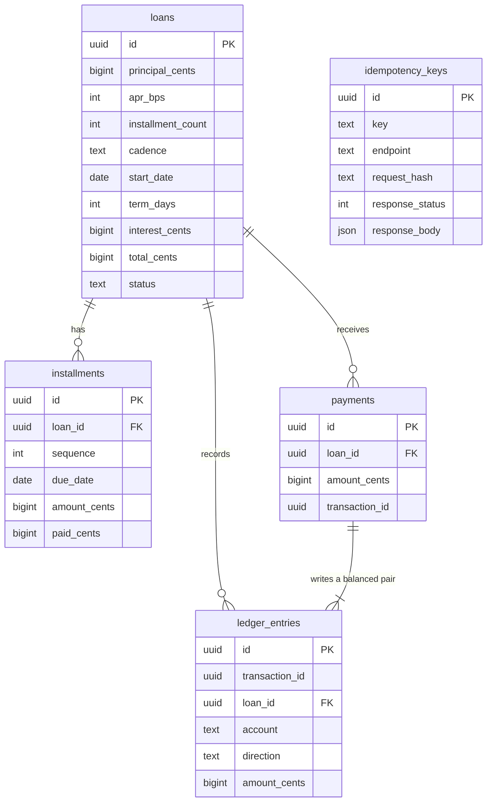

# installment-ledger

A small backend service for installment loans. You create a loan for a
principal amount over a fixed number of installments, then pay it down over
time. Every loan and every payment is recorded in a double entry ledger, and
the service is built to behave correctly when the same request arrives twice or
when two payments land at the same moment.

The point of the project is correctness under retries and concurrency, not
breadth of features.

## Schema



## Invariants, and where each one is enforced

The distinction matters: anything enforced only in application code can be
bypassed by a bad migration, a script, or a second service writing to the same
database. Anything enforced in the database cannot.

| Invariant | Enforced by | Where |
|---|---|---|
| Installments sum exactly to the total payable | application | `app/schedule.py::distribute_cents`, asserted as a property over the whole reachable input space in `tests/test_schedule_properties.py` |
| Every transaction's debits equal its credits | **database trigger** | `migrations/versions/0001_initial_schema.py`, so it holds even for a write that bypasses this service |
| Amounts are integer cents, never float | **database column type** plus application | `bigint` columns, strict integer schemas in `app/schemas.py` |
| One idempotency key yields at most one effect | **database unique index** | unique index on `idempotency_keys`, so two concurrent inserts cannot both win |
| A payment never exceeds the outstanding balance | application, under a row lock | `app/services/payments.py`, with `SELECT ... FOR UPDATE` on the loan |
| Two concurrent payments cannot interleave on one loan | **database row lock** | `SELECT ... FOR UPDATE`, verified in `tests/test_concurrency.py` with real threads |
| No installment is paid beyond its amount, or below zero | application | `app/services/payments.py`, asserted after a 24 thread storm in `tests/test_concurrency.py` |

## What idempotency does and does not guarantee

**It does:** a repeated request with the same `Idempotency-Key` on the same
endpoint returns the stored result instead of performing the action again. The
key is held in a unique index, so two threads arriving at once cannot both
insert; one wins and the other is served the stored response. This is verified
under contention with 24 threads sharing one key.

**It does not:** make the operation safe to replay with a *different* body. The
request body is hashed and stored alongside the key, so reusing a key with a
changed body is rejected rather than silently returning the old result. It also
does not expire. Keys are kept forever, with no cleanup job, so a long lived
deployment would need one.

## Design choices

**Money is integer cents.** Every stored amount and every amount on the wire is
an integer number of cents, held in a Postgres `bigint`. No float appears
anywhere. The API takes the APR as integer basis points (`apr_bps`, where 1200
means 12.00 percent) so that even the rate never arrives as a float. Amount
fields are strict integers: a JSON string or a number with a decimal point is
rejected rather than quietly coerced.

**One rounding rule.** `Decimal` is used in exactly one place, computing
interest, and the only rounding rule is `ROUND_HALF_UP` to whole cents. It is
applied once, to the total interest, never to individual installments, so
rounding cannot accumulate across a schedule.

**Simple interest, no compounding, no late fees.** Interest is
`principal * apr_bps / 10000 * term_days / 365`, where `term_days` runs from
the loan start date to the final due date. There is no compounding and there
are no late fees or penalties of any kind. That is a deliberate choice: it
keeps the arithmetic auditable and it keeps the amount owed a function of the
schedule alone rather than of when a payment happened to arrive. A service that
needed late fees would need a clock, a grace period policy and a way to reopen
a closed loan, and none of that is here.

**Installments always sum to the total.** The total payable is split with
`base = total // n` and `remainder = total % n`, and the first `remainder`
installments get one extra cent each. So 1000 cents over 3 installments becomes
334, 333, 333. Leftover cents go to the earliest installments, which means the
sum is exactly the total by construction and the borrower pays the rounding
first rather than last.

**Double entry ledger with the invariant in the database.** Creating a loan
debits `loan_receivable` for the whole amount payable and credits
`funding_payable` for the principal plus `interest_income` for the interest. A
payment debits `cash` and credits `loan_receivable`. Amounts are stored
positive and the direction carries the sign. A deferred constraint trigger
(`ledger_entries_must_balance`) sums each transaction at commit time and raises
if it does not net to zero, so an unbalanced transaction cannot be committed
even if the service layer is bypassed entirely. The tests prove this by writing
raw SQL: inserting one side of a transaction, deleting one side of a balanced
pair, and changing one amount all fail.

**Idempotency rests on a unique index.** Both POST endpoints require an
`Idempotency-Key` header. The key row carries a sha256 hash of the endpoint
plus the validated request body, and it is inserted in the same transaction as
the write it guards. A concurrent request with the same key blocks on the
unique index during its own insert, and when the first transaction commits it
gets a unique violation, rolls back, and reads the stored response instead of
writing a second time. Three consequences fall out of that:

* the same key with the same body returns the original response, byte for byte,
  because the response body is stored as written and returned verbatim;
* the same key with a different body returns 409 `idempotency_key_conflict`,
  and so does reusing a key on a different endpoint or a different loan;
* a request that fails rolls its key row back with it, so a rejected attempt
  does not burn the key and the caller can retry.

Responses are stored in a `json` column rather than `jsonb` on purpose, because
`jsonb` reorders object keys and that would make a replay merely equivalent
instead of identical.

**Row locking for concurrent payments.** A payment takes
`SELECT ... FOR UPDATE` on the loan row before it reads the balance, so a
second payment on the same loan waits and then sees the first one's effect
rather than deciding against a stale balance. Lock order is always the
idempotency row first and the loan row second, so two payments cannot deadlock
against each other. Payments on different loans do not contend at all.

**Payment application.** A payment is rejected if it exceeds the outstanding
balance. Whatever is paid fills the oldest unpaid installment first and carries
the remainder forward, and each landing is recorded in `payment_allocations`,
so partial payments are tracked installment by installment. When the last cent
is paid the loan moves to `closed` and refuses further payments.

## Running locally

### One command

```bash
docker compose up -d --build
bash scripts/demo.sh
```

That builds the API image, starts Postgres 18.6, runs the migration and serves
on `http://127.0.0.1:8000`. No `.env` and no secrets are involved.

`scripts/demo.sh` then walks the whole API and prints what came back: it creates
a loan, checks the installments sum exactly to the total, takes a payment,
retries with the same idempotency key to show the stored result returning rather
than a second payment, fires eight concurrent payments, re-checks every
invariant, and finishes by having an overpayment refused with a stable error
code.

Interactive API docs are at `http://127.0.0.1:8000/docs`, and the raw schema at
`/openapi.json`.

### Without Docker for the application

You need Docker for Postgres and Python 3.12.

```bash
docker compose up -d postgres
```

That starts Postgres 18.6 and publishes it on port 5433, which is the port the
default `DATABASE_URL` in `app/config.py` points at. Port 5433 is used so the
container does not collide with a Postgres already installed on the host. Set
`DATABASE_URL` yourself to point somewhere else.

```bash
python3.12 -m venv .venv
.venv/bin/pip install -r requirements.txt
.venv/bin/alembic upgrade head
.venv/bin/uvicorn app.main:app --reload
```

The service then answers on `http://127.0.0.1:8000`.

## Running tests

The tests need a real Postgres. They run the migration themselves and clear the
tables between tests, and the concurrency tests start a uvicorn server in a
background thread and drive it from real OS threads over HTTP.

```bash
docker compose up -d
.venv/bin/pytest
```

To run exactly what CI runs, from a clean export of `HEAD` in a throwaway
virtualenv with the pinned dependencies:

```bash
bash scripts/clean_export_check.sh
```

### What the suite covers

256 tests. Alongside the example based tests:

* **17 property based tests** (`tests/test_schedule_properties.py`, Hypothesis)
  assert the schedule invariants across the whole reachable input space rather
  than at chosen points: that installments always sum to the total, that no two
  differ by more than a cent, that the remainder always goes to the earliest
  installments, that interest is monotonic in term length, and that a loan
  starting on the 31st never produces a 31st of February.
* **8 concurrency tests** (`tests/test_concurrency.py`) run real OS threads
  against real Postgres through real HTTP, lined up on a barrier so they contend
  on purpose. The heaviest fires 24 simultaneous payments where a third share one
  idempotency key, then asserts all six invariants at once: exactly one payment
  per shared key, money applied matching the payments allowed to exist,
  outstanding never negative, installments still summing to the total, no
  installment over applied, and the ledger still balancing.

### What was measured

The suite is 256 tests and passes in about 10 seconds. That number comes from
the clean export run described above, against an empty database, on this
machine and setup:

* Apple M5 (`Mac17,2`), 10 cores, 16 GB RAM, macOS 26.6.2
* Python 3.12.15 from Homebrew, in a fresh virtualenv
* the pinned dependencies in `requirements.txt`, including ruff 0.16.10 and
  pytest 9.1.1
* Postgres 18.6 in Docker 29.7.2, running locally on the same machine

The concurrency tests use 8 threads, and the heaviest uses 24. **No throughput
or latency benchmark was run, so this README makes no claim about either.**
The timing above is how long the test suite takes, which is not a measure of
how fast the service is.

## Endpoints

| Method | Path | What it does |
| --- | --- | --- |
| `GET` | `/health` | Reports whether the database is reachable |
| `POST` | `/loans` | Creates a loan and its schedule. Requires `Idempotency-Key` |
| `GET` | `/loans/{id}` | Returns the loan, its schedule and its outstanding balance |
| `POST` | `/loans/{id}/payments` | Applies a payment. Requires `Idempotency-Key` |
| `GET` | `/loans/{id}/ledger` | Returns the ledger entries grouped by transaction |

Errors all use one shape:

```json
{"error": {"code": "overpayment", "message": "...", "details": {}}}
```

The codes are `validation_error`, `loan_not_found`, `loan_closed`,
`overpayment`, `missing_idempotency_key`, `idempotency_key_conflict` and
`idempotency_request_in_flight`.

### Example

```bash
curl -X POST http://127.0.0.1:8000/loans \
  -H 'Content-Type: application/json' \
  -H 'Idempotency-Key: demo-loan-1' \
  -d '{"principal_cents":120000,"apr_bps":0,"installment_count":4,"cadence":"biweekly","start_date":"2026-01-15"}'
```

That returns a 201 with four installments of 30000 cents due on 2026-01-29,
2026-02-12, 2026-02-26 and 2026-03-12. Sending the identical request again with
the same `Idempotency-Key` returns the same 201 and the same body, and does not
create a second loan.

## Limitations

* No authentication or authorization. Every caller can read and pay every loan.
* No real payment processor. A payment is simply asserted by the caller, and
  the `cash` account records that assertion. Nothing settles, nothing clears
  and nothing can be reversed.
* No refunds, reversals, voids or adjustments. The ledger is append only and
  there is no way to correct a mistake through the API.
* No late fees, no penalties, no compounding and no payoff quote that depends
  on the current date. Interest is fixed when the loan is created.
* Single region and single database. There is no replication, no sharding and
  no multi region story.
* `GET /loans/{id}` and `GET /loans/{id}/ledger` read without a lock, so a
  response can be a moment behind a payment that is committing concurrently.
* No pagination on the ledger endpoint, so a loan with a very large number of
  payments returns a very large body.
* No rate limiting, no metrics and no tracing. There is structured logging:
  one JSON line per request on stdout with a request id, taken from an inbound
  `X-Request-ID` when present and generated otherwise, and echoed back on the
  response.
* Idempotency keys are kept forever. There is no expiry and no cleanup job.
